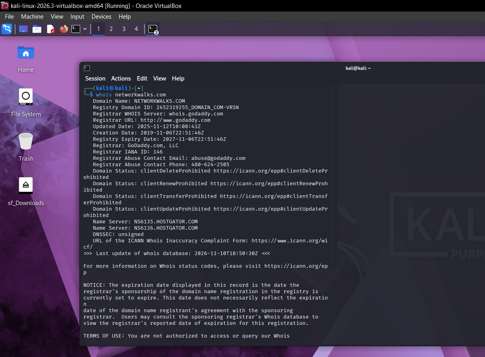
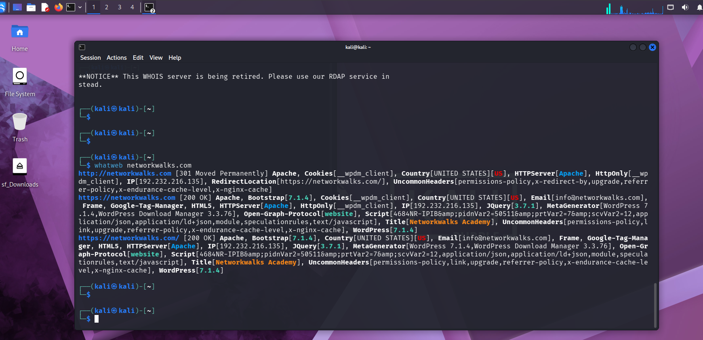
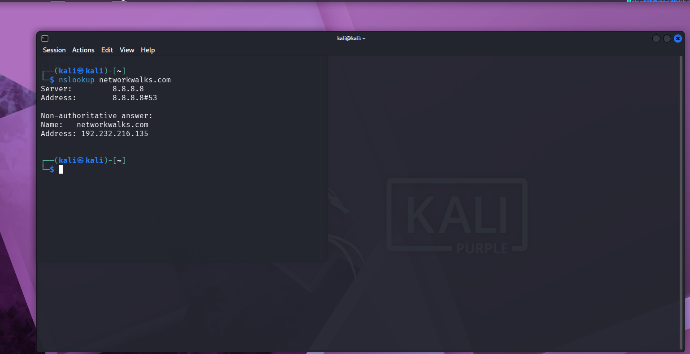
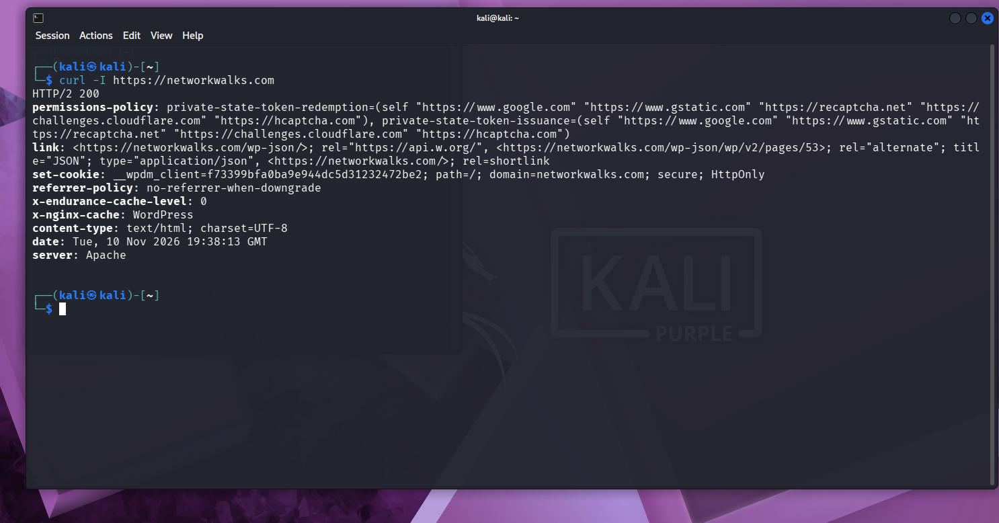
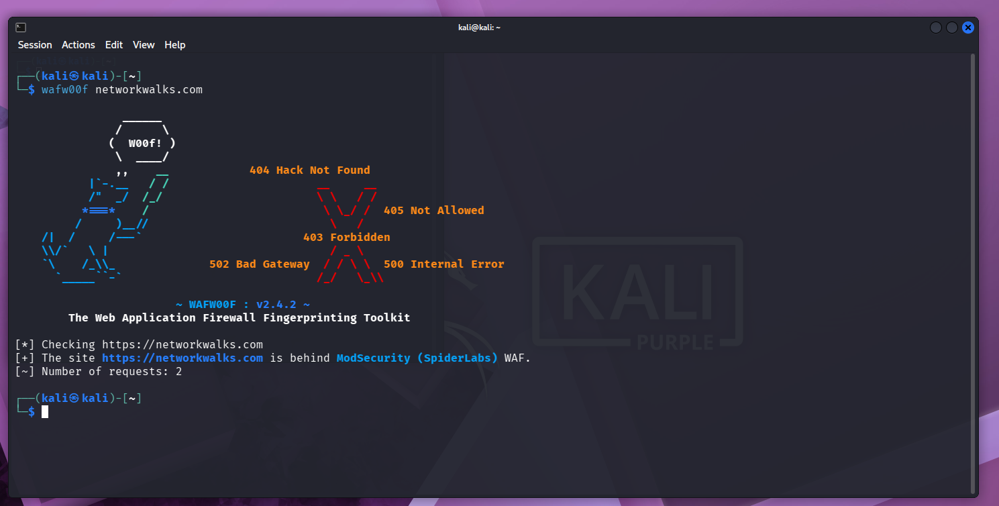
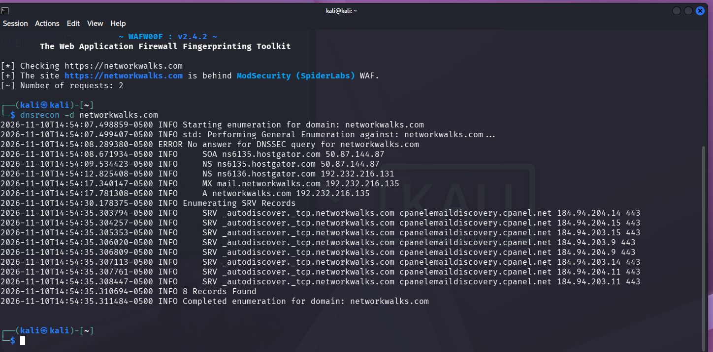
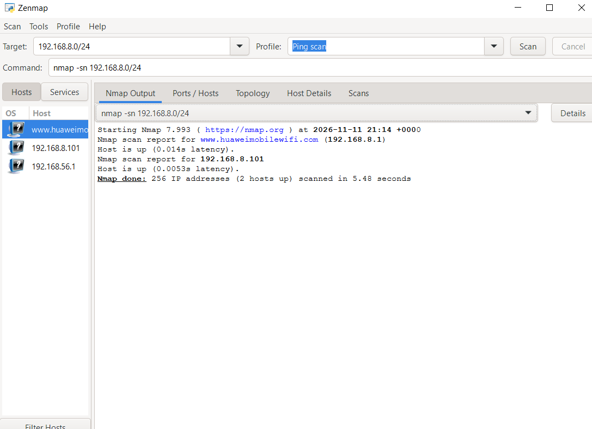
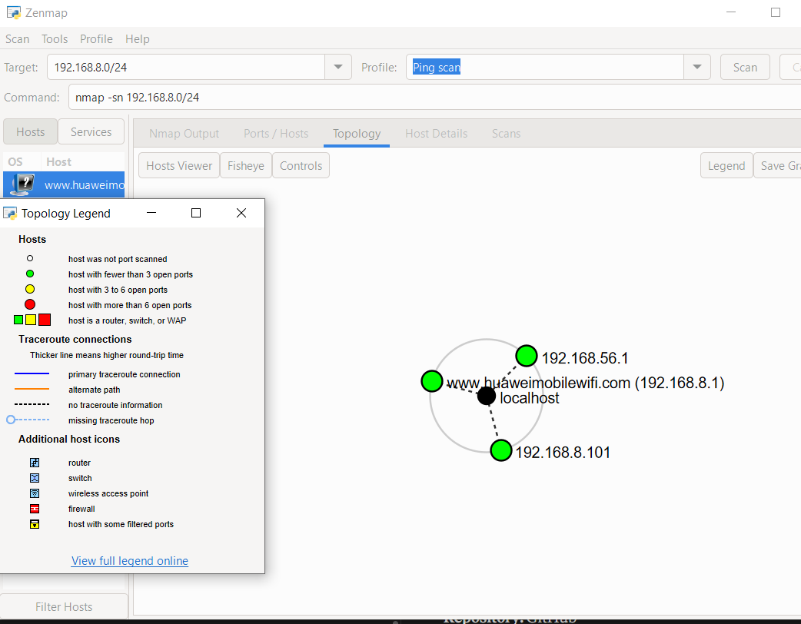

# 🔐 Penetration Testing Report

**Footprinting & Network Scanning Phases**

**W2-PM-FINAL | Cybersecurity | Networkwalks**


---

| Field | Detail |
| ----- | ------ |
| **Pentester Name (Cybersecurity Professional)** | **Carlynda Amoah** |
| **Program/Batch** | B084N-Networkwalks |
| **Date** | 11 November 2026 |
| **Modules completed** | W2-PM1 (Multiple Kali Tools)<br>W2-PM5 (Zenmap Scanning) |
| **Client/Target** | 1. Networkwalks (secured written permission already)<br>2. My own local network (Wi-Fi subnet 192.168.8.0/24) |
| **Permission secured from client?** | Yes |
| **Phases covered** | **Phase 1:** Reconnaissance & Footprinting<br>**Phase 2:** Scanning & Network Discovery<br>**Phase 3-5:** In Progress |

---

# 1. Liability Disclaimer

I have performed these activities only on the systems and devices where I had secured written permission or the devices and systems that I own myself. All these materials are for education and research purposes only. Do not use anything from here to break the law. The instructor, the authors and Networkwalks are not responsible for what you do with this knowledge. Every action you take is your own responsibility. Misuse can lead to criminal charges, heavy fines, loss of your job and a permanent record. In most countries unauthorised access is a crime even when nothing is damaged.

---

# 2. Introduction

This report covers my Week 2 practical work. In the first part (W2-PM1), I footprinted the `networkwalks.com` domain using six Kali Linux tools. In the second part (W2-PM5), I used Zenmap on my Windows PC to scan my own local network.

The first module is the footprinting phase and the second is the scanning phase. Together they show how an attacker moves from collecting public information about a target to discovering live hosts on a network.

The footprinting commands were run in Kali Linux and the scan was done in Zenmap on Windows. For each step I recorded the command, what I observed, and a screenshot as evidence.

---

# 3. Tools Used

| Tool | Purpose |
| ---- | ------- |
| Kali Linux & Windows | Operating systems used for the activities |
| WHOIS | Find domain registration details (owner, dates, name servers) |
| whatweb | Fingerprint web technologies (server, CMS, plugins, IP) |
| nslookup | Resolve the domain name to its IP address using DNS |
| curl -I | Read the HTTP response headers of the website |
| wafw00f | Detect whether a Web Application Firewall protects the site |
| dnsrecon | Enumerate DNS records (SOA, NS, MX, A, SRV) |
| Zenmap (Nmap GUI) | Scan the local subnet to find live hosts |
| Windows CMD | Find my local IP address, subnet and MAC address |

---

# 4. Activities Performed

## 4.1 Footprinting & Reconnaissance

I ran six Kali Linux tools against `networkwalks.com`. Each one revealed a different piece of information.

**WHOIS**

```bash
whois networkwalks.com
```

The domain is registered with GoDaddy, was created on 6 November 2019, and is set to expire on 6 November 2027. The name servers are `NS6135.HOSTGATOR.COM` and `NS6136.HOSTGATOR.COM`, which points to HostGator as the hosting provider. DNSSEC is unsigned.

**WhatWeb**

```bash
whatweb networkwalks.com
```

The site redirects from HTTP to HTTPS and runs on Apache. WhatWeb identified **WordPress 7.1.4** and **WordPress Download Manager 3.3.76**, along with jQuery 3.7.1. It also exposed the server IP address and the email address `info@networkwalks.com`.

**Nslookup**

```bash
nslookup networkwalks.com
```

Using the DNS server `8.8.8.8`, the domain resolved to **192.232.216.135**.

**Curl**

```bash
curl -I https://networkwalks.com
```

The response was `HTTP/2 200` and the server banner showed `Apache`. The headers also showed an `x-nginx-cache: WordPress` value, a secure `HttpOnly` cookie, and a link to the WordPress REST API endpoint `/wp-json/`.

**Wafw00f**

```bash
wafw00f networkwalks.com
```

Wafw00f (v2.4.2) reported that the site is behind a **ModSecurity (SpiderLabs)** Web Application Firewall, using 2 requests.

**DNSRecon**

```bash
dnsrecon -d networkwalks.com
```

DNSRecon listed the SOA and name server records, which point to HostGator (`ns6135.hostgator.com` and `ns6136.hostgator.com`), the mail server `mail.networkwalks.com`, and the A record for the domain at `192.232.216.135`. It also found 8 SRV records for `_autodiscover._tcp` that point to cPanel's email discovery service on port 443. The DNSSEC query returned no answer, which matches the unsigned DNSSEC result from WHOIS.

## 4.2 Network Scanning with Zenmap

For the second activity, I used Zenmap to discover live hosts on my local network. The task was to find my local IP address and subnet, discover live hosts, find their IP and MAC addresses, and save the network topology.

First, I ran `ipconfig` in Command Prompt. My PC connects to the network through Wi-Fi, so I used the Wi-Fi adapter:

```text
Wireless LAN adapter Wi-Fi:
   IPv4 Address. . . . . . . . . . . : 192.168.8.100
   Subnet Mask . . . . . . . . . . . : 255.255.255.0
   Default Gateway . . . . . . . . . : 192.168.8.1
```

The other address on my PC, `192.168.56.1`, belongs to VirtualBox's virtual Host-Only adapter. It has no gateway, so it is not my LAN. My LAN subnet is therefore `192.168.8.0/24`.

Then I entered the subnet in Zenmap, selected the **Ping scan** profile, and clicked Scan:

```text
Target:  192.168.8.0/24
Command: nmap -sn 192.168.8.0/24
```

Zenmap scanned 256 IP addresses in 5.48 seconds and found **2 live hosts**:

| IP address | Details |
| ---------- | ------- |
| `192.168.8.1` | My Wi-Fi router and default gateway (shown by Zenmap as `www.huaweimobilewifi.com`) |
| `192.168.8.101` | Another device on the network |

My own PC (`192.168.8.100`) is not listed in the Zenmap results.

Finally, I opened the **Topology** tab, turned on the legend, and saved the topology graphic as a PDF. The topology also shows `192.168.56.1`, the VirtualBox Host-Only address of my own PC, which is left over from an earlier scan of `192.168.56.0/24`.

---

# 5. Problem Encountered

**The MAC address did not appear in Zenmap.**

After the ping scan, Zenmap listed the live hosts but did not show their MAC addresses. I solved this by running the following command in Command Prompt, which lists the **Physical Address** (MAC address) of each network adapter on my PC:

```text
ipconfig /all
```

Nmap shows the MAC addresses of other devices on the network, but it does not list the MAC address of the computer it is running on. That is why I had to get my own MAC address from Windows. In the screenshot below, part of the MAC address is hidden for privacy.

---

# 6. Risk Analysis / Impact

Based on the information collected during these activities, I identified the following potential risks.

| # | Risk / Finding | Evidence / Observation | Potential Impact | Risk Level |
| - | -------------- | ---------------------- | ---------------- | ---------- |
| 1 | Web technology and version information exposed | WhatWeb identified WordPress 7.1.4 and WP Download Manager 3.3.76 | Attackers may use exposed version information to look for known weaknesses that need further review | 🟠 Medium |
| 2 | Server IP address identifiable | Nslookup resolved the domain to `192.232.216.135` | Shows the network location of the web service | 🟢 Low |
| 3 | HTTP technical information exposed | Curl returned headers showing Apache and the `/wp-json/` endpoint | May help technology fingerprinting and further enumeration | 🟢 Low |
| 4 | WAF technology identifiable | Wafw00f identified ModSecurity (SpiderLabs) | Reveals information about the web application's security setup | 🟢 Low |
| 5 | DNS infrastructure information exposed | DNSRecon listed the name servers, a mail server and 8 cPanel SRV records | DNS information can help build a wider profile of the infrastructure | 🟠 Medium |
| 6 | Live hosts visible on the local network | Zenmap found 2 live hosts on `192.168.8.0/24` (`192.168.8.1` and `192.168.8.101`) | Ping scans reveal active devices, so any unexpected device should be investigated | 🟢 Low |

**Risk level key:** 🔴 Critical | 🟠 Medium | 🟢 Low

These are observations from footprinting and scanning, not confirmed vulnerabilities. No exploitation or vulnerability validation was performed in these two modules. Seeing a software version, IP address or DNS record does not by itself mean a system is vulnerable. Further authorized testing would be needed to confirm any real vulnerability.

---

# 7. Recommendations

1. **Review what is publicly exposed.** Organizations should regularly check what information about their web technologies, CMS and plugins can be seen publicly.
2. **Keep software updated.** CMS platforms and plugins should be updated regularly and checked against current security advisories.
3. **Review HTTP headers.** Remove technical details from response headers that are not needed.
4. **Review DNS records regularly.** Make sure only required records and services are public.
5. **Keep the WAF enabled and tuned.** ModSecurity is already in place and should be monitored and configured properly.
6. **Scan your own network regularly.** Periodic internal discovery helps identify active devices.
7. **Investigate unknown devices.** Any unexpected host found in a scan should be verified.
8. **Document the network.** Keep network topology and device information up to date.
9. **Only test with authorization.** Reconnaissance and scanning should only be done on systems where permission has been given.

---

# 8. Conclusion

In Week 2, I completed practical work on footprinting, reconnaissance and network scanning.

In the footprinting activity, I used six Kali Linux tools to learn about `networkwalks.com`: WHOIS for registration details, WhatWeb for web technologies, Nslookup for the IP address, Curl for HTTP headers, Wafw00f for the firewall, and DNSRecon for DNS records. In the scanning activity, I used Zenmap to find live hosts on my local subnet and view the network topology.

**What I learned:**

- **Footprinting is the first step.** An attacker starts by finding and tracing the information that targets leave exposed to the public. The tools only read what is already public, which is why footprinting is hard to detect.
- **The phases of hacking.** The phases are reconnaissance (footprinting), scanning, gaining access, maintaining access, and covering tracks. In ethical hacking, the work ends with report writing instead of covering tracks.
- **Troubleshooting matters.** When Zenmap did not show my MAC address, I found it with `ipconfig /all`, and I learned why Nmap does not list the MAC of the computer it runs on.
- **Documentation and authorization.** A good report explains what was done, what was found, and why it matters, and all testing must stay within an authorized scope.

---

# 9. Evidence Collected

*Screenshots collected as evidence during the activities:*

**WHOIS**



**WhatWeb**



**Nslookup**



**Curl**



**Wafw00f**



**DNSRecon**



**Zenmap ping scan**



**Zenmap topology**



-End-

---

# 👤 Author

**Carlynda Amoah**\
Cybersecurity Professional B084N

LinkedIn: [https://www.linkedin.com/in/carlynda-amoah-530779292/](https://www.linkedin.com/in/carlynda-amoah-530779292/)

---

## 📌 Project Information

**Program Name:** Cybersecurity program at Networkwalks | **Week:** 02 | **Repository:** GitHub
